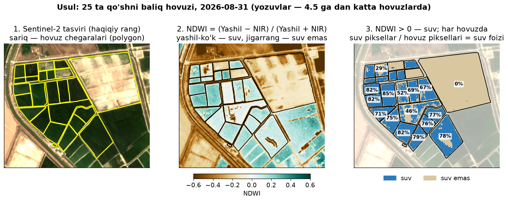
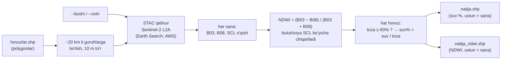
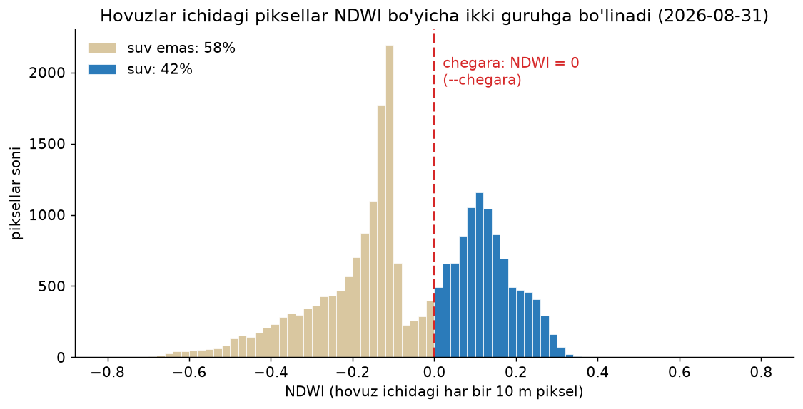
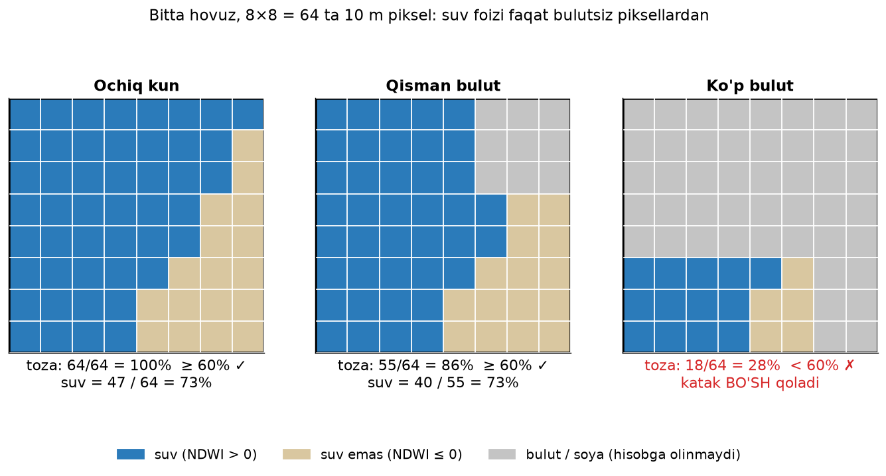
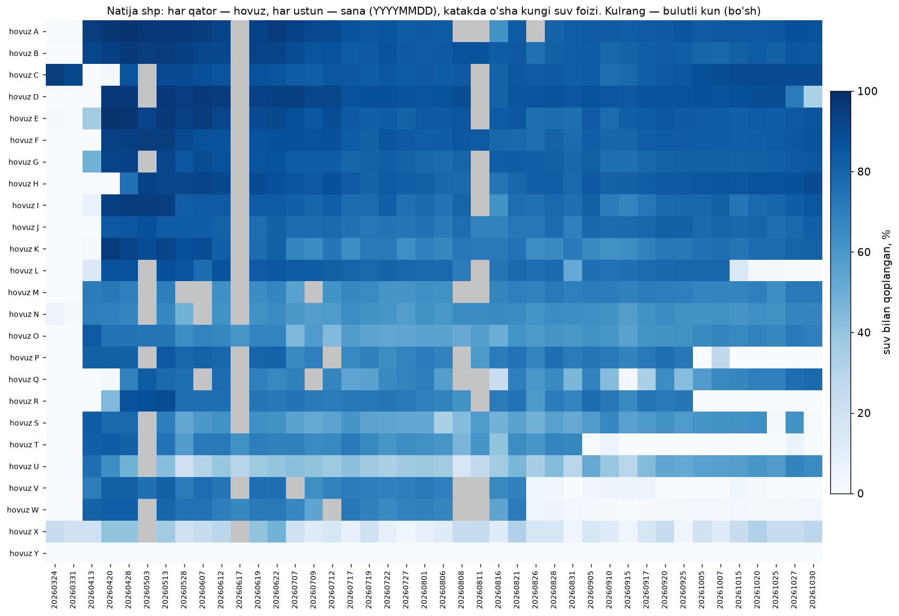
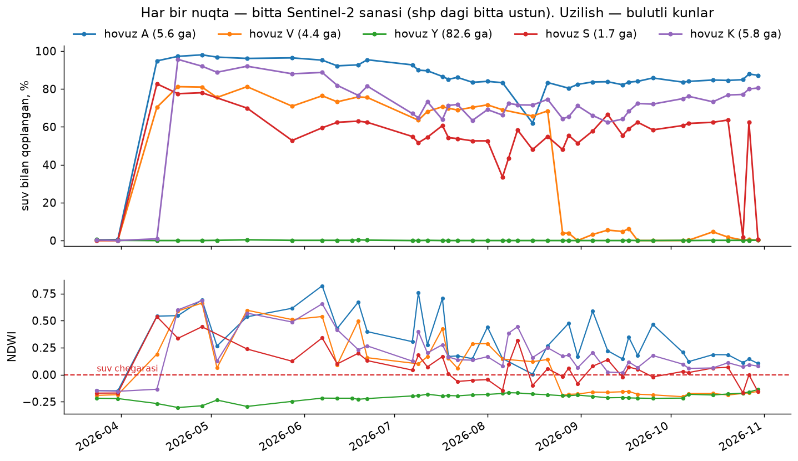

# baliq_suv_qoplanishi — baliq hovuzlarining suv bilan qoplanishi (Sentinel-2, NDWI)

Baliq hovuzlari polygonlari va sana oralig'i beriladi. Skript shu oraliqdagi **har bir Sentinel-2 tasviri**
uchun har bir hovuzning **qancha foizi suv bilan qoplanganini** hisoblaydi va shp ga yozadi: har bir sana
alohida ustun (`20260301`, `20260304`, …). NDWI qiymatining o'zi ham xuddi shunday ustunlar bilan yonma-yon
faylga yoziladi.



## Qisqacha

```powershell
.\run.bat ndwi_hovuz.py --hovuz D:\Tasks\baliq\Suv_yo\Suv_yo.shp --boshi 2026-03-01 --oxiri 2026-10-31 --chiqish D:\Tasks\baliq\natija\sirdaryo_baliq.shp
```

Natija:

| fayl | ichida |
|---|---|
| `sirdaryo_baliq.shp` | har sana ustunida o'sha kungi **suv bilan qoplangan maydon, %** (0–100) |
| `sirdaryo_baliq_ndwi.shp` | xuddi shu ustunlar, ichida o'sha kungi hovuz **NDWI** o'rtachasi (−1…1) |

## Ishlash tartibi



### 1. Hovuz piksellari

Har bir hovuz Sentinel-2 ning **10 m** to'riga tushiriladi. **Markazi polygon ichida** bo'lgan piksellar o'sha
hovuzniki hisoblanadi. Polygon asosiy chegara bo'lib xizmat qiladi: hovuzdan tashqaridagi suv (kanal, qo'shni
hovuz) hisobga kirmaydi. Polygonlar ~20 km li kataklarga guruhlanadi va har guruh o'zining kichik to'rida
o'qiladi, shuning uchun respublika bo'ylab tarqalgan hovuzlar ham tez ishlaydi.

### 2. NDWI va suv

```
NDWI = (Yashil − NIR) / (Yashil + NIR)        Sentinel-2: B03 (yashil), B08 (NIR), 10 m — McFeeters (1996)
```

Suv yashil nurni qaytaradi, infraqizil (NIR) nurni esa deyarli to'liq yutadi. Shuning uchun suvda NDWI > 0
bo'ladi. O'simlik va quruq tuproqda NIR yuqori, NDWI < 0. **NDWI > 0 bo'lgan piksel suv hisoblanadi**
(chegarani `--chegara` bilan o'zgartirish mumkin).

Hovuzlar ichidagi piksellar NDWI bo'yicha ikki guruhga bo'linadi. Chegara (0) ular orasidagi chuqurlikka
to'g'ri keladi:



### 3. Suv foizi va bulut

```
suv_foiz = suv piksellar / toza piksellar × 100
```

**Toza piksel** deganda bulut, bulut soyasi yoki qor bo'lmagan piksel tushuniladi (Sentinel-2 ning SCL qatlami
bo'yicha 2, 4, 5, 6, 7 sinflari). Bulut ostidagi piksel na suv, na quruq deb hisoblanadi, chunki uning ostida
nima borligi noma'lum.

Hovuzning toza qismi **60% dan kam** bo'lsa (`--min-toza 0.6`), o'sha kungi katak **bo'sh** qoladi. Bu shart
**bulutga** tegishli, suvga emas. Ochiq kunda 0% suv ham, 100% ham yoziladi, bo'sh katak esa faqat bulutli
kunni bildiradi:



Bulutli kun nega tashlab yuboriladi: hovuzning 90% i bulut ostida bo'lsa, foiz qolgan bir necha piksel
bo'yicha chiqadi. Ular qirg'oqqa tushsa, to'la hovuz "0% suv" bo'lib ko'rinadi.

## Natija

Har hovuz bitta qator, geometriya va CRS kirishdagidek. Har sana alohida ustun:

```
sirdaryo_baliq.shp        unique_id  maydon_ga  piksel  20260413  20260420  20260428 ...
                          2c6470f5…     5.5953     562      94.8      97.2      98.0 ...   <- suv bilan qoplangan, %
sirdaryo_baliq_ndwi.shp   unique_id  maydon_ga  piksel  20260413  20260420  20260428 ...
                          2c6470f5…     5.5953     562     0.541     0.546     0.692 ...   <- NDWI
```

| ustun | |
|---|---|
| `<id>` | hovuz ID (`unique_id`, `id`, `uniqueid` yoki `hovuz_id`; bo'lmasa 1..n qo'shiladi) |
| `maydon_ga` | hovuz maydoni, ga |
| `piksel` | hovuzdagi 10 m piksellar soni (kam bo'lsa, natija ishonchsizroq) |
| `YYYYMMDD` | o'sha kungi suv foizi yoki NDWI; bulutli kunda **bo'sh** |

Hamma hovuzda bulutli bo'lgan sanaga ustun ochilmaydi. Suv qoplagan maydonni gektarda olish uchun:
`suv_foiz / 100 × maydon_ga`.

Quyida natija shp jadval ko'rinishida (25 ta qo'shni hovuz, 2026 yil mart–oktyabr). Har qator hovuz, har
ustun sana:



Jadvaldan ko'rinadiki, aprel o'rtasida hovuzlar suvga to'ldirilgan. Avgust–oktyabrda ba'zilari
(**V, W, T, R, P, L**) bo'shatilgan, **Y** esa butun mavsum quruq turgan.

Xuddi shu ma'lumotning vaqt qatori (har nuqta shp dagi bitta ustun):



- **A** — butun mavsum to'la (~85–95%);
- **V** — avgust oxirida bo'shatilgan (~68% → ~4%);
- **S** — mavsum bo'yi ~50–65%, oktyabr oxirida bo'shatilgan;
- **Y** (82.6 ga) — suv qo'yilmagan, NDWI doim manfiy.

Pastki grafikda NDWI 0 dan yuqori bo'lsa suv bor. Hovuz to'la bo'lsa ham NDWI kundan-kunga o'zgaradi (loyqa,
suvo'tlari, shamol). Shuning uchun asosiy ko'rsatkich NDWI ning o'zi emas, **suv foizi**.

## Parametrlar

| Parametr | Ma'nosi |
|---|---|
| `--hovuz` | hovuz polygonlari (.shp, .gpkg, .geojson …); CRS bo'lishi shart, ixtiyoriy CRS bo'laveradi |
| `--boshi`, `--oxiri` | sana oralig'i, `YYYY-MM-DD` (ikkalasi ham kiradi) |
| `--chiqish` | `.shp` (standart), `.gpkg`, `.csv`, `.xlsx`. Berilmasa: kirish yonida `<nom>_suv_<boshi>_<oxiri>.shp` |
| `--qatlam` | gpkg ichidagi qatlam nomi |
| `--id` | hovuz ID ustuni |
| `--chegara` | NDWI chegarasi (standart **0.0**); suvo'tli yoki loyqa hovuzlarda −0.05 … −0.1 bo'lishi mumkin |
| `--min-toza` | hovuzning kamida shuncha ulushi bulutsiz bo'lsa kun yoziladi (standart **0.6**) |
| `--bulut-max` | sahna buluti shu foizdan kam bo'lgan sahnalar olinadi (standart 80) |
| `--scl` | toza SCL sinflari, vergul bilan (standart `2,4,5,6,7`) |
| `--manba` | `aws` (Earth Search, standart) yoki `pc` (Planetary Computer) |
| `--ishchi` | parallel yuklashlar soni (standart 6) |

Chiqish turlari:

- `.shp` — ikki fayl: `<nom>.shp` (suv %) va `<nom>_ndwi.shp`;
- `.gpkg` — bitta faylda `suv_foiz` va `ndwi` qatlamlari;
- `.xlsx` — bitta faylda `suv_foiz` va `ndwi` varaqlari;
- `.csv` — ikki fayl, geometriyasiz.

Shp da ko'pi bilan **254 ta ustun** bo'ladi. Bitta plitkada yiliga ~150 sana bor, plitkalar ustma-ust tushsa
ko'proq. Sig'masa, skript to'xtaydi: davrni bo'lib bering yoki `.gpkg` ga yozing.

Tezlik: 25 ta qo'shni hovuz uchun 8 oy (49 kun) ~1 daqiqa, 10 ta tarqoq hovuz uchun 3 oy ~2 daqiqa davom etdi.
Vaqtning asosiy qismi tasvir yuklashga ketadi, shuning uchun u hovuzlar soniga emas, guruhlar va kunlar
soniga bog'liq.

## Cheklovlar

- **Kichik hovuzlar.** 10 m pikselda 0.1 ga hovuz atigi ~10 piksel bo'ladi. Damba va qirg'oqdagi aralash
  piksellar foizni bir necha punktga o'zgartiradi, shuning uchun `piksel` ustuniga qarang. Birorta piksel
  markazi tushmagan juda kichik hovuz bo'sh qoladi.
- **Suvo'tlar.** Suv yuzasini suvo'tlari qoplagan (gullagan) bo'lsa, NIR ko'tariladi va NDWI 0 dan pastga
  tushishi mumkin, ya'ni suvli hovuz "quruq" ko'rinadi. NDWI ham shu sababli yoziladi: suv foizi keskin
  tushib, NDWI 0 atrofida qolsa, bu suvo'tining belgisi bo'lishi mumkin.
- **Bulut soyasi.** Sen2Cor ba'zan qorong'i suvni "bulut soyasi" (SCL 3) deb belgilaydi. Ochiq kunda ham katta
  suvli hovuz katagi bo'sh qolsa, `--scl 2,3,4,5,6,7` bilan sinab ko'ring.

## O'rnatish

Conda (conda-forge) muhiti kerak:

```powershell
conda env create -f environment.yml
```

`run.bat` avval `baliq_suv` muhitini, u bo'lmasa `fenologiya` muhitini ishlatadi (`conda activate` shart
emas). Muhit faollashtirilgan bo'lsa, to'g'ridan-to'g'ri ham ishga tushirish mumkin: `python ndwi_hovuz.py …`.
Sentinel-2 tasvirlari internetdan o'qiladi (AWS Earth Search, ochiq, kalit kerak emas).

| Fayl | Vazifasi |
|---|---|
| `ndwi_hovuz.py` | asosiy skript (mustaqil, boshqa fayl kerak emas) |
| `test_ndwi.py` | NDWI va foiz hisobining testi (sun'iy ma'lumot): `.\run.bat test_ndwi.py` |
| `rasmlar/yasash.py` | README rasmlarini qayta yasash: `.\run.bat rasmlar\yasash.py --hovuz H.gpkg --natija N.gpkg` |
| `run.bat` | Windows da ishga tushirish |
| `environment.yml` | conda muhiti |
